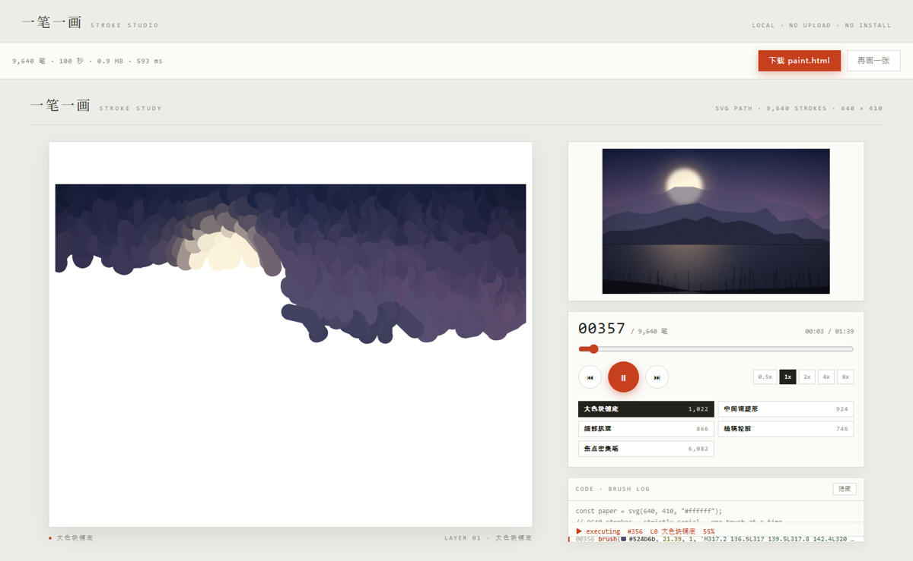
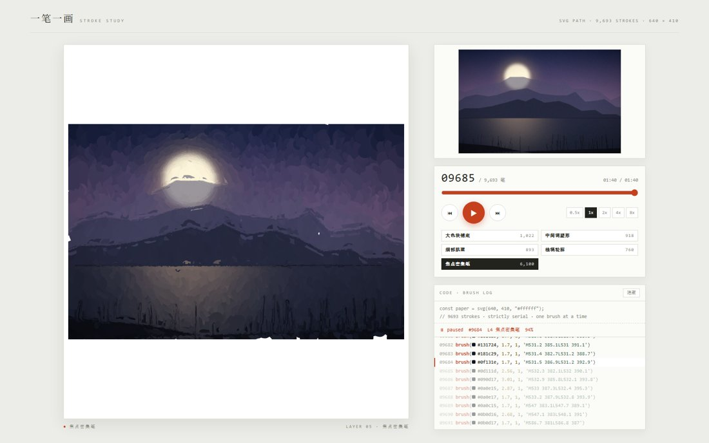
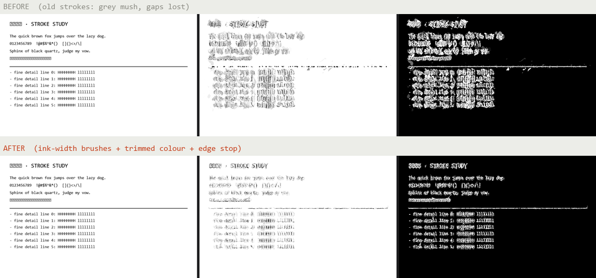

# 一笔一画 · stroke-paint

把任意一张图片变成**一笔一笔画出来**的过程动画：几千条 SVG 笔触按严格串行的时间轴落笔，配一个可拖拽、可按图层看、带"笔刷日志"的播放器。整页是**一个自包含 HTML**，双击就能看，也能直接发给别人。

不需要安装任何东西——**下载仓库，双击 `studio.html`，把图拖进去**，就出结果。

**在线试用（连下载都省了）**：<https://fkr3301.github.io/stroke-paint/> —— 打开就把图拖进去。



## 三种用法

### 1. 浏览器里一键生成（推荐，零安装）

1. 打开 <https://fkr3301.github.io/stroke-paint/>（或下载仓库后双击 `studio.html`，Chrome / Edge / Safari / Firefox 都行）；
2. 把图片**拖进去**，或点击选择、`Ctrl+V` 粘贴；
3. 几秒后下面直接开始画，点「下载 paint.html」拿走成品。

整条流水线跑在你自己的浏览器里：**图片不会上传到任何服务器**，断网也能用，隐私安全。

### 2. 命令行（批量、可控参数，需要 Node 16+）

```bash
node scripts/paint.js 你的图.jpg --out out/我的画
# -> out/我的画/paint.html  preview.html  strokes.json  meta.json
```

```bash
node scripts/paint.js photo.png --preset fine --seconds 150 --title 星空 --out out/sky
```

| 参数 | 默认 | 说明 |
| --- | --- | --- |
| `--out DIR` | `./stroke-paint-out` | 输出目录 |
| `--preset` | `normal` | `quick`(440px/4层) · `normal`(640px/6层) · `fine`(820px/6层) |
| `--width N` | 由 preset 决定 | 分析宽度，越大人脸/发丝/蕾丝越清晰 |
| `--layers N` | 由 preset 决定 | 最高图层 0–5，`3` = 只画到线稿，更松弛 |
| `--seconds N` | `100` | 1× 播放总时长 |
| `--title` / `--sub` | `一笔一画` / `STROKE STUDY` | 页头文字 |
| `--names "a\|b\|c\|d\|e\|f"` | 自动 | 自定义六个图层名 |
| `--no-preview` | 关 | 不生成 `preview.html` |

### 3. 作为 DSH 技能

仓库根目录就是技能本体（`SKILL.md` + `scripts/` + `templates/`），放进 `~/.dsh/skills/stroke-paint/` 即可，之后直接说"把这张图做成绘画过程"就会命中它。

### 在线版怎么来的（想在别人仓库复现）

本仓库已启用 GitHub Pages（分支 `main` / 根目录，含 `.nojekyll`）：

- 根地址 `https://fkr3301.github.io/stroke-paint/` 由 `index.html` 跳转到 `studio.html`；
- 直接分享 `https://fkr3301.github.io/stroke-paint/studio.html` 也可以。

别人 fork 后照做：`Settings → Pages → Deploy from a branch → main / (root)`，一分钟生效。

## 成品长什么样



上面这张是 `examples/sample.jpg`（程序生成的示例图）画完的样子：9,693 笔。

播放器里可以：

- 播放 / 暂停（空格）、上一笔 / 下一笔（← →）、0.5×–8× 变速
- 拖时间轴任意跳转；点图层标签跳到"该层画完"的那一帧
- 看右下角真实的笔刷日志：`brush(#2a213d, 24.61, 1, 'M5.9 26.9L4.9 …')`
- 深链分享某一刻：`paint.html#t=52.4`、`paint.html#layer=3`

## 原理

六层笔刷，从大色块到细节，每笔的颜色取自原图对应像素，方向取自图像的结构张量（顺着边缘走）：

| 层 | 内容 | 触发 |
| --- | --- | --- |
| L0 大色块铺底 | 24px 宽、30–44px 长的宽笔 | 全图网格 |
| L1 中间调塑形 | 8.5px | 局部对比度 > P65 |
| L2 细部肌理 | 4.2px | > P88 |
| L3 线稿轮廓 | 1–2px 长线，沿对比度脊线追踪 | > P93 起笔 |
| L4 焦点密集笔 / 五官与手 | 2.9px + 1.7px 短笔 | 肤色掩膜 ∪ 细节最密区 |
| L5 高光星点 | 点/短线 | 亮斑检测 |

时间轴严格串行（同一时刻只有一支笔在动），时长按笔长/层速加权后归一到 `--seconds`；`strokes.json` 里每笔是 `[路径, 颜色, 线宽, 不透明度, 开始时刻, 时长, 层号]`。

### 高反差图片（线稿 / 漫画 / 文字 / 逆光硬高光）

笔刷会自动适应硬边，不用加参数：

- **笔宽被局部"墨宽"限制**：靠近硬边的地方，笔宽收缩到不超过墨的宽度（2px 的线就用 2px 的笔），
  但在深色/中间调区域仍然用宽笔——那里收细只会露白；
- **取色用去极值中位数**：一笔横跨黑白边界时，取它覆盖的那一侧的颜色，而不是平均成灰；
- **遇到明暗突变就收笔**（约 0.26），不会把一条边糊成灰带。

实测（PSNR / 边缘相关性，640px 网格）：文字页 18.1→**20.4** dB、线稿 13.9→**15.7** dB、
逆光窗户 21.0→**24.6** dB，人像同时从 23.9→**24.5** dB（风格不变）。



细线依然受**分辨率**限制：640px 网格装不下 1px 的线。文字、漫画、UI 截图建议
`--width 900`（或源图宽度，取小者）；网页版在「精细度」里选"精细（慢）"。

更多细节见 [`references/how-it-works.md`](references/how-it-works.md)。

## 文件结构

```
studio.html              ← 零安装一键版（由 scripts/build-studio.js 生成）
SKILL.md                 ← 技能说明（DSH / Agent 读这个）
scripts/
  core.js                ← 全部算法，无 Node/DOM 依赖，命令行与浏览器共用
  paint.js               ← 命令行：解码 → core → 写文件
  png.js                 ← 零依赖 PNG 解码（调色板/灰度/16bit/透明）
  convert.py             ← webp/heic/tiff… 转 PNG（需要 Pillow）
  build-studio.js        ← 把 core + 模板 + 示例图打包成 studio.html
  studio.shell.html      ← 一键版页面外壳
templates/player.html    ← 播放器（可改配色/版式）
templates/preview.html   ← 原图 vs 分层对比页
vendor/jpeg-js/          ← JPEG 解码（MIT，见其 LICENSE）
examples/                ← 示例图与其成品、生成脚本
docs/                    ← README 用截图
```

## 输入格式

- 浏览器版：JPG / PNG / WebP / GIF / AVIF / BMP（用浏览器原生解码，支持透明）
- 命令行版：JPG / PNG 原生；其他格式先用 `python scripts/convert.py in.webp out.png` 转换

## 已知限制

- 源图小于约 600px 会显得块状：放大源图不会增加细节，只会更糊。
- 一张图超过约 2 万笔时页面会变大（2MB+），拖动进度条略钝；用 `--width 520` 或 `--preset quick` 变轻。
- 平涂无对比度的图（纯色 logo）画出来接近色块填充，属正常。
- `studio.html` 里内置的示例图可用 `python examples/make-sample.py` 重新生成。

## 许可

MIT（见 [LICENSE](LICENSE)）。项目内置了 `vendor/jpeg-js`（同为 MIT，版权归其作者），
其声明与免责说明见 [THIRD-PARTY-NOTICES.md](THIRD-PARTY-NOTICES.md)。仓库内的示例图由
`examples/make-sample.py` 程序生成，不含任何第三方素材。
